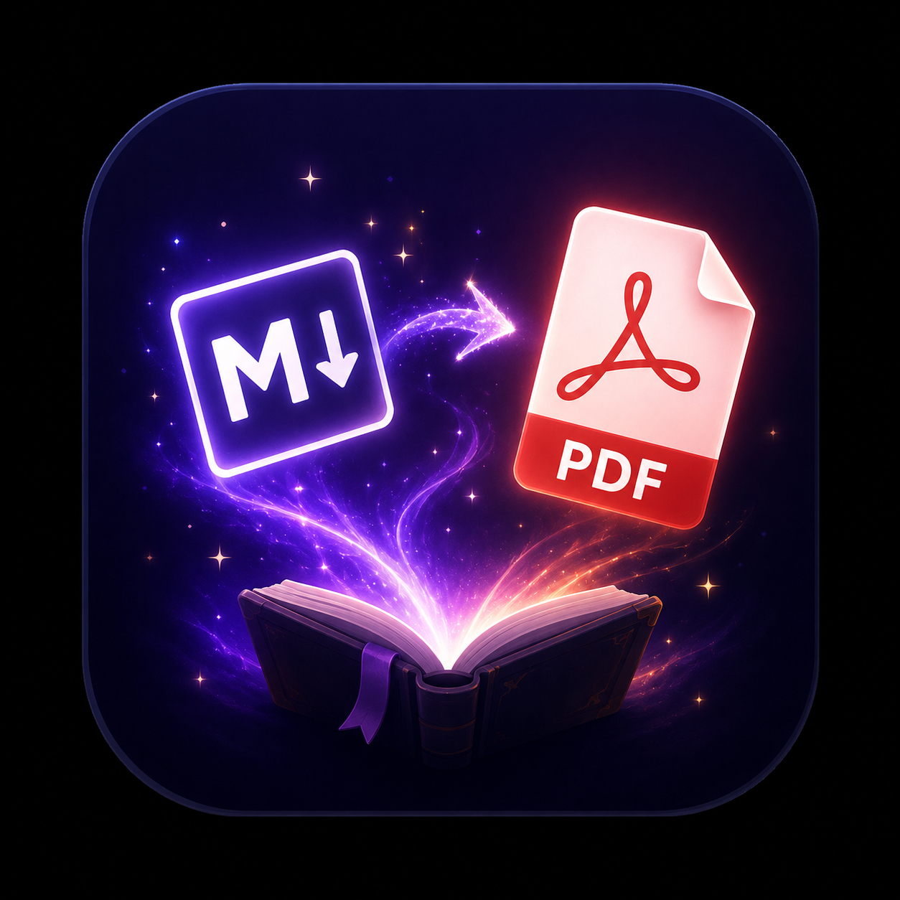
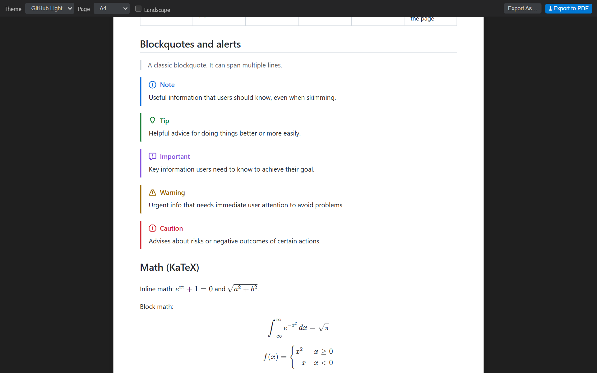
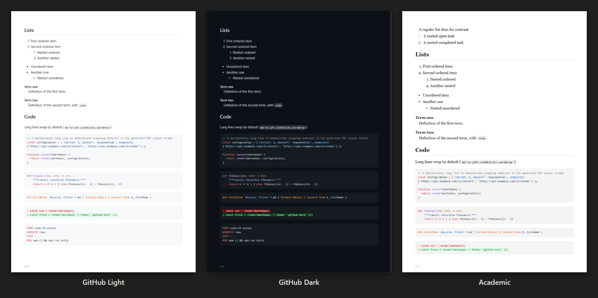
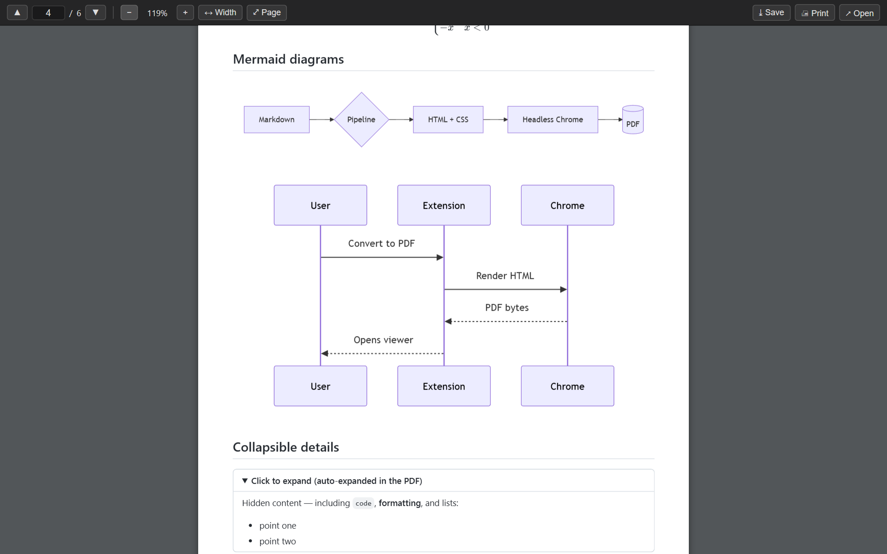

<p align="center">
  
</p>

<h1 align="center">Advanced MD to PDF</h1>

<p align="center">
  <b>Turn Markdown into polished PDFs in one click: with Mermaid diagrams, KaTeX math, GitHub alerts, themes, a page-accurate live preview, and a built-in PDF viewer.</b>
</p>

<p align="center">
  <a href="LICENSE"></a>
</p>

---

## 🚀 Quick start

1. Open any `.md` file.
2. Press **`Ctrl+Alt+P`** (`Cmd+Alt+P` on macOS), or click the **PDF** icon in the editor title bar.
3. The PDF opens right inside VS Code. That's it: no setup, and Chrome is detected (or downloaded) automatically.

Want to see it before exporting? Click the **preview** icon (`Ctrl+K Ctrl+Alt+V`).



## ✨ Features

| | |
|---|---|
| 👀 **Live preview** | Drawn at the real paper size, margins, and orientation, so wrapping matches the PDF. Updates as you type. |
| 🎨 **Themes** | `github-light`, `github-dark`, and `academic`, plus custom CSS and font overrides. |
| 📊 **Mermaid diagrams** | ` ```mermaid ` blocks are rendered to crisp vector graphics. |
| 🧮 **Math** | KaTeX inline `$…$` and block `$$…$$`, with bundled fonts. |
| 📣 **GitHub alerts** | `> [!NOTE]`, `[!TIP]`, `[!IMPORTANT]`, `[!WARNING]`, `[!CAUTION]`. |
| 📑 **Rich Markdown** | TOC, footnotes, emoji, task lists, definition lists, sub/sup, `==highlight==`, abbreviations, and `<details>` (auto-expanded). |
| 🔍 **Built-in PDF viewer** | Zoom and fit, selectable text with `Ctrl/Cmd+F`, clickable TOC and web links, and auto-refresh on re-export. |
| 🖨️ **Page control** | Headers and footers with page numbers, manual page breaks, and per-document options in front matter. |
| 📂 **Batch export** | Convert a multi-selection or a whole folder, with cancellable progress. |
| ⚡ **Fast and zero-config** | A shared headless Chrome, Edge, Chromium, or Brave. If none is installed, Chrome is downloaded once and reused offline. |

<p align="center">
  
</p>

Try [`examples/feature-showcase.md`](examples/feature-showcase.md) to see every feature in one document.

## 📖 Usage

### Convert
| Where | How |
|---|---|
| Editor title bar | Click the **PDF** icon |
| Keyboard | `Ctrl+Alt+P` (Windows/Linux) · `Cmd+Alt+P` (macOS) |
| Status bar | Click **PDF** while a Markdown file is open |
| Context menu | Right-click a `.md` file in the Explorer or editor → **Convert to PDF** (select several files to convert them all) |
| Choose location | Command Palette → **Advanced MD to PDF: Export to PDF (choose location)…** |
| Whole folder | Right-click a folder → **Convert All Markdown in Folder** |

### Live preview
Click the **preview** icon in the editor title bar, press `Ctrl+K Ctrl+Alt+V` (`Cmd+K Cmd+Alt+V` on macOS),
or run **Advanced MD to PDF: Open PDF Preview**. The toolbar changes the **theme**, **page size**, and
**orientation** for this document. **Export to PDF** / **Export As…** use exactly those choices.
Links work too: `#anchors` scroll the preview, relative `.md` links open in the editor, and web links open in
your browser.

> The preview doesn't take over `Ctrl+K V`, so VS Code's built-in *Markdown: Open Preview to the Side* keeps
> that shortcut.

### Built-in PDF viewer



Generated PDFs open in an in-editor viewer. It has page navigation, zoom, fit-width / fit-page, selectable and
searchable text (`Ctrl/Cmd+F`), clickable links, and *Save a copy*, *Print*, and *Open externally* buttons.
When you re-export, the viewer refreshes automatically and keeps your page and zoom. Large documents stay
smooth because only the pages near the viewport are kept in memory.

**Keyboard:** `Page Up` / `Page Down`, `Home` / `End`, `Ctrl/Cmd +` / `-` to zoom, and `Ctrl/Cmd+0` to fit
width.

The viewer doesn't replace your default PDF app. To use it for any other PDF, right-click the file →
**Open With…** → **MD to PDF Viewer**. If you'd rather use your system viewer for exports, set
`md-to-pdf.viewer` to `system`.

### Page breaks
Put `<!-- pagebreak -->`, `\pagebreak`, or `\newpage` on a line of its own where a new page should start.

### Per-document options (front matter)
A `pdf:` block in the YAML front matter overrides your settings for that document. The preview toolbar and
the *askOptionsOnConvert* prompts still take precedence over it.

```yaml
---
title: Quarterly Report        # used for the {title} header/footer token and the preview title
pdf:
  theme: academic              # github-light | github-dark | academic
  format: Letter               # A4 | Letter | Legal | A3 | A5 | A6 | Tabloid
  landscape: true
  margins: 20mm                # or a map with top / right / bottom / left
  toc: false                   # disable [[toc]] and heading anchors
---
```

## ⚙️ Settings

### Output & layout
| Setting | Default | Description |
|---------|---------|-------------|
| `md-to-pdf.openAfterConversion` | `true` | Automatically open the PDF after conversion |
| `md-to-pdf.askOptionsOnConvert` | `false` | Prompt for theme / page size / orientation each time you run **Convert to PDF** |
| `md-to-pdf.pageFormat` | `"A4"` | A4, Letter, Legal, A3, A5, A6, Tabloid |
| `md-to-pdf.landscape` | `false` | Render pages in landscape orientation |
| `md-to-pdf.scale` | `1` | Render scale (0.1–2) to shrink wide content |
| `md-to-pdf.margins` | `{...}` | Page margins (top, right, bottom, left) |
| `md-to-pdf.onFileExists` | `"overwrite"` | `overwrite` or `newFile` (adds a sequence number) |
| `md-to-pdf.outputDirectory` | `""` | Where to write PDFs (relative to the source file, or absolute). Supports `${workspaceFolder}`, `${fileDirname}`, `${userHome}`, and `~` |
| `md-to-pdf.viewer` | `"internal"` | `internal` (built-in viewer) or `system` (default app) |
| `md-to-pdf.header` / `md-to-pdf.footer` | `{ enabled: false }` | Running header/footer; tokens: `{title} {date} {pageNumber} {totalPages} {filePath}` |

### Styling
| Setting | Default | Description |
|---------|---------|-------------|
| `md-to-pdf.theme` | `"github-light"` | `github-light`, `github-dark`, or `academic` |
| `md-to-pdf.customCss` | `""` | Path to a CSS file appended after the theme (same path variables; relative `url(...)` inside it resolve against the CSS file) |
| `md-to-pdf.fonts` | `{}` | `body`, `mono`, and `size` overrides |

### Content & rendering
| Setting | Default | Description |
|---------|---------|-------------|
| `md-to-pdf.mermaid.enabled` / `md-to-pdf.mermaid.theme` | `true` / `"auto"` | Render Mermaid diagrams and choose their theme |
| `md-to-pdf.math.enabled` | `true` | Render KaTeX math |
| `md-to-pdf.alerts.enabled` | `true` | Render GitHub-style alerts/callouts |
| `md-to-pdf.toc.enabled` | `true` | `[[toc]]`/`[TOC]` and heading anchors |
| `md-to-pdf.toc.levels` | `[1, 2, 3]` | Heading levels listed in the table of contents |
| `md-to-pdf.emoji` | `true` | Render `:emoji:` shortcodes |
| `md-to-pdf.extraSyntax` | `true` | Definition lists, sub/sup, `==mark==`, abbreviations |
| `md-to-pdf.expandDetails` | `true` | Expand `<details>` so content is visible |
| `md-to-pdf.embedImages` | `true` | Embed local images as data URIs |
| `md-to-pdf.linkRenderUrls` | `false` | Print the URL after external links |
| `md-to-pdf.codeBlocks.wordWrap` | `true` | Wrap long code lines instead of clipping |
| `md-to-pdf.tables.wide` | `"wrap"` | `wrap` cells or `shrink` font for wide tables |
| `md-to-pdf.convertFolder.recursive` | `false` | Include subfolders when converting a folder |

### Browser
| Setting | Default | Description |
|---------|---------|-------------|
| `md-to-pdf.browserPath` | `""` | Explicit Chrome/Chromium/Edge/Brave path (auto-detected, then auto-downloaded, if empty). User settings only |
| `md-to-pdf.timeout` | `120000` | Max time (ms) to wait while rendering. Set to `0` to disable for very large documents |

### Example configuration

```json
{
  "md-to-pdf.theme": "github-dark",
  "md-to-pdf.pageFormat": "Letter",
  "md-to-pdf.footer": {
    "enabled": true,
    "template": "{pageNumber} / {totalPages}"
  },
  "md-to-pdf.tables.wide": "shrink",
  "md-to-pdf.linkRenderUrls": true
}
```

## 🛠️ Troubleshooting

| Problem | Fix |
|---|---|
| *"Chrome … not found and automatic download failed"* | Install Chrome, Edge, Chromium, or Brave, or set `md-to-pdf.browserPath` in your **user** settings. |
| Conversion times out on a huge document | Raise `md-to-pdf.timeout`, or set it to `0`. Splitting into chapters and using **Convert All Markdown in Folder** is faster. |
| *"… is open in another program"* | Another app (e.g. Acrobat on Windows) is locking the PDF. Close it, or pick **Save As…** in the error message. |
| `customCss` / `outputDirectory` / `browserPath` seem ignored | In [Restricted Mode](https://code.visualstudio.com/docs/editor/workspace-trust), workspace settings can't change these. Trust the folder or set them in user settings. |
| A font looks different in the PDF | Fonts referenced only by name must be installed locally. Bundle web fonts via `customCss` with `@font-face`. |
| Something else | Check the **MD to PDF** output channel (*View → Output*) and [open an issue](https://github.com/hsynkmk/Advanced-MD-to-PDF/issues). |

## 🔒 Security

- Scripts inside Markdown (raw `<script>` tags, `onerror=` handlers, …) are blocked while the PDF is
  rendered, and the page can't make network requests from script. A document you convert can't read and
  send away your local files.
- `md-to-pdf.browserPath` can only be set in *user* settings, so a cloned repository's
  `.vscode/settings.json` can't make the extension launch an arbitrary program.
- In [Restricted Mode](https://code.visualstudio.com/docs/editor/workspace-trust), workspace settings can't
  change `browserPath`, `customCss`, or `outputDirectory`.
- Chrome's sandbox stays on. It's only disabled on Linux when VS Code itself runs as root (e.g. in
  containers), where Chrome can't start otherwise.

## 📋 Requirements

- **VS Code** 1.85 or newer
- **Browser:** Chrome, Chromium, Microsoft Edge, or Brave. It's detected automatically, and Chrome is
  downloaded once if none is found.

## 🤝 Contributing

Contributions are welcome! Feel free to open an issue or submit a pull request.

```bash
npm install
npm test        # copies assets, compiles, runs unit tests + a real-Chrome PDF smoke test
npm run lint
npm run build   # bundles out/extension.js (press F5 in VS Code to try it)
```

See [CHANGELOG.md](CHANGELOG.md) for release notes.

## 📄 License

[MIT](LICENSE) © Huseyin Kaymak

---

<p align="center">If this extension saves you time, please consider leaving a ⭐ <a href="https://marketplace.visualstudio.com/items?itemName=hsynkmk.Advanced-MD-to-PDF&ssr=false#review-details">review on the Marketplace</a>.</p>
