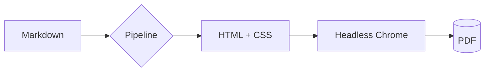
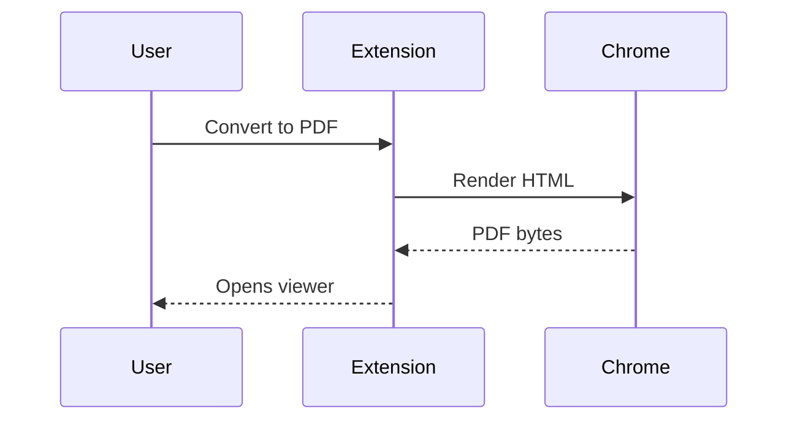
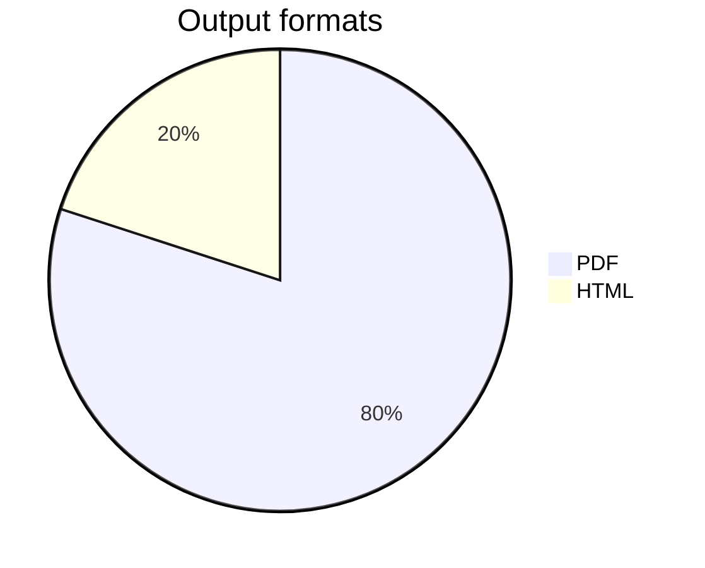

# Feature Showcase

This document exercises every feature the extension supports. Export it to PDF
(or open the live preview) to see them all at once.

[[toc]]

## Text formatting

**Bold**, *italic*, ~~strikethrough~~, ==highlighted==, `inline code`,
H~2~O (subscript), x^2^ (superscript), and a keyboard key: <kbd>Ctrl</kbd>+<kbd>Alt</kbd>+<kbd>P</kbd>.

The HTML spec is maintained by the W3C. Abbreviations like HTML get dotted underlines.

*[HTML]: HyperText Markup Language
*[W3C]: World Wide Web Consortium

Links: [external link](https://github.com/hsynkmk/Advanced-MD-to-PDF),
[internal anchor](#task-lists), and an auto-linked URL: https://code.visualstudio.com

Emoji shortcodes: :rocket: :sparkles: :white_check_mark: :warning:

## Task lists

- [ ] An open task
- [x] A completed task
- [X] Also completed (capital X)
- [ ] A task with **bold**, `code`, and a [link](https://example.com)
- A regular list item for contrast
  - [ ] A nested open task
  - [x] A nested completed task

## Lists

1. First ordered item
2. Second ordered item
   1. Nested ordered
   2. Another nested
- Unordered item
- Another one
  - Nested unordered

Term one
: Definition of the first term.

Term two
: Definition of the second term, with `code`.

## Code

Long lines wrap by default (`md-to-pdf.codeBlocks.wordWrap`):

```javascript
// A deliberately long line to demonstrate wrapping behavior in the generated PDF output format
const configuration = { retries: 3, backoff: 'exponential', endpoints: ['https://api.example.com/v1/convert', 'https://api.example.com/v1/render'] };

function convert(markdown) {
  return render(markdown, configuration);
}
```

```python
def fibonacci(n: int) -> int:
    """Classic recursive fibonacci."""
    return n if n < 2 else fibonacci(n - 1) + fibonacci(n - 2)
```

```powershell
Get-ChildItem -Recurse -Filter *.md | ForEach-Object { Convert-Item $_.FullName }
```

```diff
- const old = render(markdown);
+ const fresh = render(markdown, { theme: 'github-dark' });
```

```dockerfile
FROM node:20-alpine
WORKDIR /app
COPY . .
RUN npm ci && npm run build
```

## Tables

| Feature | Setting | Default |
|---------|---------|---------|
| Themes | `md-to-pdf.theme` | `github-light` |
| Math | `md-to-pdf.math.enabled` | `true` |
| Mermaid | `md-to-pdf.mermaid.enabled` | `true` |

A wide table (wraps or shrinks per `md-to-pdf.tables.wide`):

| Identifier | Description | URL | Hash | Status | Notes |
|------------|-------------|-----|------|--------|-------|
| conversion-pipeline-alpha | Renders markdown through the shared pipeline | https://example.com/very/long/path/to/a/resource | 3f786850e387550fdab836ed7e6dc881de23001b | active | Long unbroken strings should wrap instead of overflowing the page |

## Blockquotes and alerts

> A classic blockquote.
> It can span multiple lines.

> [!NOTE]
> Useful information that users should know, even when skimming.

> [!TIP]
> Helpful advice for doing things better or more easily.

> [!IMPORTANT]
> Key information users need to know to achieve their goal.

> [!WARNING]
> Urgent info that needs immediate user attention to avoid problems.

> [!CAUTION]
> Advises about risks or negative outcomes of certain actions.

## Math (KaTeX)

Inline math: $e^{i\pi} + 1 = 0$ and $\sqrt{a^2 + b^2}$.

Block math:

$$
\int_{-\infty}^{\infty} e^{-x^2} \, dx = \sqrt{\pi}
$$

$$
f(x) = \begin{cases} x^2 & x \ge 0 \\ -x & x < 0 \end{cases}
$$

## Mermaid diagrams





## Collapsible details

<details>
<summary>Click to expand (auto-expanded in the PDF)</summary>

Hidden content — including `code`, **formatting**, and lists:

- point one
- point two

</details>

## Footnotes

Here is a statement that needs a citation[^1], and another one[^2].

[^1]: The first footnote, rendered at the end of the document.
[^2]: The second footnote, with a [link](https://example.com).

## Mermaid inside collapsed details

<details>
<summary>A diagram hidden in a collapsed section</summary>



</details>

## Horizontal rule

---

## Page breaks

The next section starts on a new page:

<!-- pagebreak -->

## After the page break

A `<!-- pagebreak -->` comment (or a `\pagebreak` / `\newpage` line) forces a new page.

That's everything. :tada:
